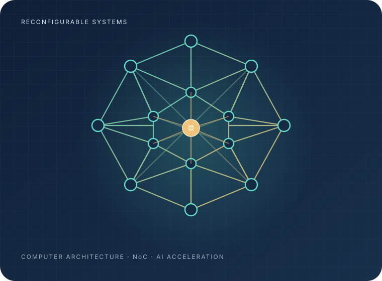

<section class="af-hero" aria-label="Introduction">
  

    
Research · Architecture · Innovation

    <h1>Arash Firuzan</h1>
    
Exploring efficient computer architectures, reconfigurable interconnects, and hardware systems for AI acceleration.

    
Computer ArchitectureAI AcceleratorsNetwork-on-Chip

    

      <a class="af-hero__button af-hero__button--primary" href="/publications/">View publications</a>
      <a class="af-hero__button" href="https://scholar.google.com/citations?user=Ezu-7uYAAAAJ&amp;hl=en">Google Scholar ↗</a>
    

  

  
</section>

I work on computer architecture and hardware systems for efficient data movement and deep-learning acceleration. My current research interests focus on reconfigurable Network-on-Chip (NoC) architectures, accelerator interconnects, and optimization methods for mapping processing elements and communication resources.

This website presents selected research directions, implementation work, and technical materials. Project descriptions distinguish ongoing design and evaluation from experimentally validated results; performance claims are included only when supported by reproducible measurements.

## Research interests

- **AI accelerator architecture:** dataflows, processing-element arrays, and efficient communication for neural-network workloads
- **Network-on-Chip:** topology design, routing, arbitration, switching, and reconfigurable links
- **Hardware optimization:** graph models, placement, traffic-aware configuration, and differential-equation-inspired methods
- **RTL and architecture evaluation:** SystemVerilog, simulation, synthesis flows, and reproducible benchmarking

## Selected research

### Muqarnas-NoC

A hierarchical, reconfigurable NoC concept inspired by the geometric organization of Muqarnas. The design explores structured communication domains, configurable lateral and express paths, and routing mechanisms for many-core accelerator fabrics.

[Explore Muqarnas-NoC →](/portfolio/muqarnas-noc/)

### ANDE — Adaptive Network Differential Equations

An optimization-oriented framework for exploring processing-element placement and interconnect configuration. Its mathematical direction combines continuous optimization and discrete network constraints; convergence properties and practical effectiveness require analytical and experimental validation.

[Explore ANDE →](/portfolio/ande/)

## Research software

Implementation notes, source code, and selected artifacts are published through the [GitHub profile](https://github.com/Afiruzan).

## Collaboration

I welcome technical discussion and research collaboration in computer architecture, AI accelerators, NoC design, and hardware evaluation. The best starting point is my [Google Scholar profile](https://scholar.google.com/citations?user=Ezu-7uYAAAAJ&hl=en) or [GitHub profile](https://github.com/Afiruzan).
